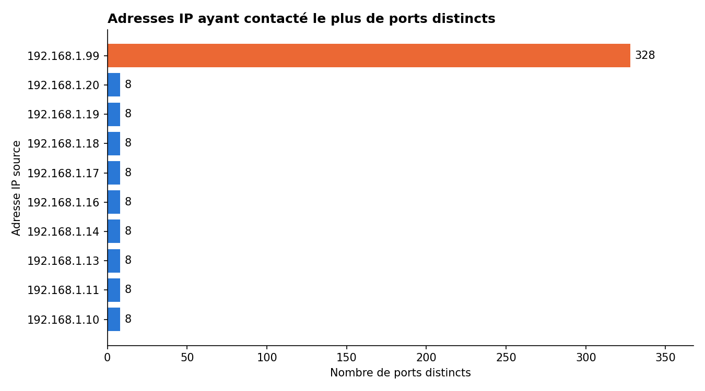
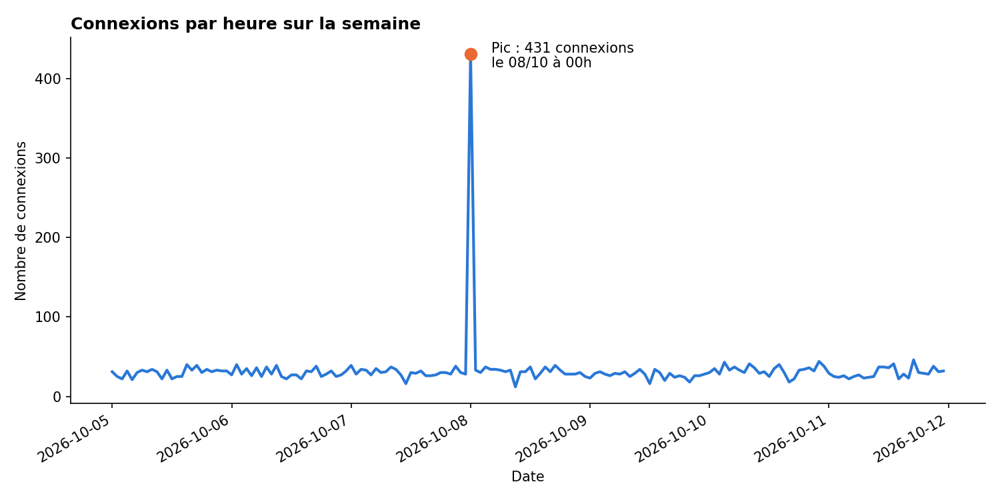
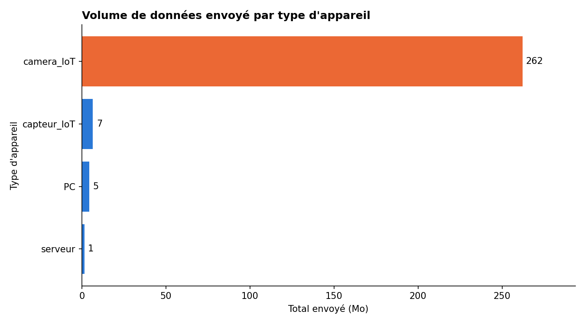

# Rapport d'analyse des journaux du pare-feu

**Auteur :** Ramata Diallo
**Période analysée :** du 5 au 11 octobre 2026

## 1. Résumé

Après nettoyage, le journal compte 5 440 connexions sur une semaine. L'activité est globalement régulière, avec environ 30 connexions par heure, et le trafic principal est du web sécurisé (port 443, 1 874 connexions). Le pare-feu a bloqué 13,57 % des connexions (738 sur 5 440). Deux comportements sortent clairement de la normale : un scan de ports le 8 octobre et un envoi massif de données par une caméra le 10 octobre. Le pare-feu a bloqué la majorité du scan, mais il a laissé passer tous les gros envois de la caméra.

## 2. Comportements suspects

### 2.1 Scan de ports par 192.168.1.99

Le PC `192.168.1.99` a contacté **328 ports distincts**, alors qu'aucune autre adresse n'en a contacté plus de 8. Il a effectué 400 connexions en 15 minutes, le 8 octobre entre 00:00 et 00:15, toutes vers le serveur `10.0.0.5`. Ce volume crée un pic de 431 connexions dans l'heure, contre environ 30 habituellement.

Le pare-feu a bloqué 383 de ces connexions, mais **17 ont été autorisées**, sur 17 ports différents. L'heure, la cible unique et le grand nombre de ports indiquent une recherche automatique de services ouverts, et non une utilisation normale.

### 2.2 Exfiltration probable par 192.168.1.11

La caméra `192.168.1.11` a envoyé environ **260 Mo** sur la semaine, soit près de 95 % de tous les octets du journal. L'adresse suivante n'a envoyé qu'environ 0,6 Mo.

Ce volume vient presque entièrement de **38 envois réalisés le 10 octobre**, pour un total d'environ 259 Mo (jusqu'à 8,7 Mo par envoi, alors que la médiane du réseau est de 1 710 octets). Ils ont tous la même destination, l'adresse externe `8.8.8.8` sur le port 8080, et ont tous été autorisés.

Une caméra n'a pas de raison normale d'envoyer autant de données vers cette adresse. Le journal ne montre toutefois pas le contenu des envois : l'exfiltration est donc probable, mais pas prouvée. La caméra a pu être compromise, ce qu'une analyse de l'appareil devra confirmer.

## 3. Recommandations de sécurité

1. **Traiter les deux appareils en priorité.** Isoler `192.168.1.11` et `192.168.1.99` du réseau, puis les analyser. Vérifier aussi sur `10.0.0.5` les 17 ports atteints pendant le scan.
2. **Bloquer le flux suspect.** Ajouter une règle de pare-feu qui refuse les connexions de `192.168.1.11` vers `8.8.8.8:8080`.
3. **Segmenter les objets connectés.** Placer les caméras et les capteurs dans un VLAN séparé, et n'autoriser que les destinations nécessaires à leur fonctionnement. Tout le reste du trafic sortant doit être refusé par défaut.
4. **Fermer Telnet.** Le journal compte 100 connexions vers le port 23, dont 26 autorisées. Telnet n'étant pas chiffré, il faut bloquer ce port et utiliser SSH à la place.
5. **Mettre en place des alertes.** Déclencher une alerte quand une adresse contacte beaucoup de ports en peu de temps, ou quand un appareil envoie un volume inhabituel vers l'extérieur.
